# [Trần Lê Gia Bảo](https://github.com/bjruly)

Information Technology student at Saigon University, passionate about building real-world software and game development.  
Currently growing through hands-on projects — where clean code meets practical impact.

  

---

## Currently

- Studying: Machine Learning, Object-Oriented Analysis & Design, C#, Software Engineering
- Building: a personal expense tracker in Python + Streamlit + SQLite
- Exploring: simple 2D games with Pygame as a starting point toward Unity

---

## Stack

**Languages**

**Frontend**

**Backend & Frameworks**

**Database**

**Game Development**

**Source Code Management**

**Tools & IDE**

---

## Coursework

| Course | Focus |
|---|---|
| Data Structures & Algorithms | Core structures, complexity, problem solving |
| Object-Oriented Programming | Classes, inheritance, polymorphism |
| Object-Oriented Analysis & Design | Modeling and designing systems with OO principles |
| Databases | Relational design, SQL |
| C# Programming | Application development on .NET |
| Software Engineering | Software lifecycle, teamwork, documentation |
| AI Foundations & Machine Learning | Search, learning from data, model basics |
| Graph Theory & Web Development | Graph algorithms, building web pages |

---

## Interests

Passionate about games — especially MOBA, sports, and survivor genres.  
Right now focused on building simple games to understand the fundamentals before moving on to more complex mechanics and systems.

---

## Projects

| Project | Description | Stack |
|---|---|---|
| [Beijing Multi-Site Air Quality](https://github.com/bjruly/sgu_finalproject_machinelearning_2026-2027) | Machine Learning final project predicting PM2.5 concentrations and analyzing air quality with the Beijing Multi-Site Air Quality Dataset. Compares Linear Regression, Random Forest, XGBoost, and MLP regression models. | Python, Pandas, NumPy, Scikit-learn, XGBoost, Matplotlib, Seaborn |
| [Sports Court Booking System](https://github.com/bjruly/sports-court-booking-system) | C# course final project developing an online sports-court booking system for customers, court owners, and administrators. Structured as a .NET 8 modular monolith with ASP.NET Core MVC and Razor; planned storage and external-service integrations are distinguished from the current foundation. | C#, .NET 8, ASP.NET Core MVC, Razor, Docker, Docker Compose, PostgreSQL 16; planned: EF Core, Npgsql, Redis, VNPay/MoMo, Email/SMS, Map Services |
| [Multilingual Auto-Narration System](https://github.com/bjruly/SE_2026) ([Live Demo](https://se-2026-psi.vercel.app/)) | A campus-guide prototype for Saigon University that provides automatic narration in Vietnamese, English, and Chinese when users enter campus locations. Includes a web PWA, mobile app, API, admin dashboard, and CI/CD; the web demo is deployed on Vercel. | Next.js, React Native (Expo), Node.js, Express, PostgreSQL, MapLibre, OpenFreeMap, GitHub Actions, Vercel |
| [Cinema Booking Management System](https://github.com/bjruly/OOAD_2026) | Object-Oriented Analysis and Design project for a cinema booking and management system at Saigon University. | Java, Java Swing, MySQL, JDBC, Maven, ZXing, MVC Architecture |
| [Auto Import Prices](https://github.com/bjruly/final_project_MachineLearning) | Regression-focused Machine Learning final project predicting automobile import prices from the UCI Automobile dataset. Covers EDA, data cleaning, preprocessing, 10 baseline regression models, 5-fold cross-validation, stacking, hyperparameter tuning, and evaluation. | Python, Pandas, NumPy, Scikit-learn, Matplotlib, Seaborn |
| [Simple Calculator](https://github.com/hp1206/Simple_Calculator) | A lightweight, Casio-inspired desktop calculator built with Pygame, featuring a familiar calculator-style layout and basic arithmetic operations. | Python, Pygame |
| [expense-tracker](https://github.com/bjruly/expense-tracker) | Personal finance tracker with expense management, analytics, and budget alerts. | Python, Streamlit, SQLite |

---

## GitHub Stats

---

## Contact

- Email: bumjruly06@gmail.com
- GitHub: [@bjruly](https://github.com/bjruly)

---

## Contribution Snake

---

